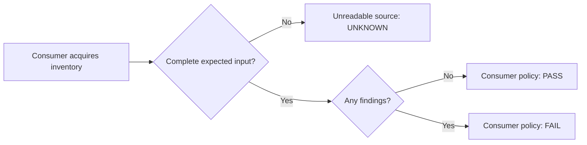

# A failed read is not an empty result

An empty inventory and an unavailable inventory can both become `[]` after an
error handler. They support different conclusions. A complete empty result may
pass your check; a source you could not consult leaves the answer unknown.

This guide runs that distinction using [Source Read's published
v0.2.0](https://github.com/nymrel/source-read/releases/tag/v0.2.0) API. Source Read
is a small Python helper with no third-party runtime dependencies. Your
application still acquires the data, validates its shape and defines the policy.

## The failure that disappears

A fallback such as this loses the difference before a check can assess it:

```python
try:
    findings = load_inventory()
except (OSError, ValueError):
    findings = []
```

If the next step treats `not findings` as success, a failed read can look clean.
An empty list alone cannot recover the failure information.

Keep the acquisition outcome alongside the value instead:



## Run three cases from an installed package

Use Python 3.11 or newer. Source Read is not published on PyPI; install the
reviewed source asset rather than a similarly named registry package. Its
SHA-256 URL fragment lets pip check the source ZIP before building it:

Start in a new consuming directory outside the portal and Source Read checkouts.
Stay in that directory for every command below:

```text
mkdir source-check-consumer
cd source-check-consumer
python -m venv ../source-read-demo
```

On POSIX:

```sh
../source-read-demo/bin/python -m pip install "https://github.com/nymrel/source-read/releases/download/v0.2.0/source-read-0.2.0.zip#sha256=6cee0ef1816d992a4b6cd5ee9414d3e280495e263011f5e1aae3af946a49a30c"
../source-read-demo/bin/python -I -c "import source_read; assert source_read.__version__ == '0.2.0'"
```

On Windows, use `../source-read-demo/Scripts/python` in place of
`../source-read-demo/bin/python`. Ordinary pip installation creates an isolated
build environment; the owning repository documents its separate
[hash-locked build validation](https://github.com/nymrel/source-read/blob/main/CONTRIBUTING.md).

Copy [source-check.py](../examples/source-check.py) into that consuming directory.
It reads a controlled UTF-8 JSON file, accepts one complete array of
findings, and caps input at 64 KiB. Create two synthetic files there:

```text
empty.json       []
findings.json    ["synthetic finding"]
```

The filename is the left column; write only the JSON value into each file. Leave
`missing.json` absent. Run each command separately:

```sh
../source-read-demo/bin/python -I source-check.py empty.json
# PASS sources=1 exit_code=0
../source-read-demo/bin/python -I source-check.py findings.json
# FAIL sources=1 exit_code=1
../source-read-demo/bin/python -I source-check.py missing.json
# UNKNOWN sources=1 exit_code=2
```

The example deliberately exits with that code. A shell or CI job should expect
the second and third commands to fail. The library itself returns an assessment;
the consuming program chooses to exit.

Inside the example, the boundary is small:

```python
read = SourceRead.ok(value, label=path)  # successful complete array
# or, after acquisition/shape validation fails:
read = SourceRead.unreadable(path, "unavailable", empty=[])
result = assess_check([read], passed=not read.value)
```

For this inventory policy, nonempty means findings and therefore FAIL. An
unreadable source forces UNKNOWN even if its neutral value is `[]`. Supplying no
source records also defaults to UNKNOWN: that differs from reading one source
whose value is an empty array.

The executable example also keeps malformed JSON, an unexpected object such as
`{"error": "timeout"}`, invalid UTF-8 and oversized input UNKNOWN. Its output
omits paths, error details and inventory contents. Counts and outcomes can still
be sensitive in a real application.

## Where the caller must do more

This example's completeness contract applies to a controlled local JSON file.
An HTTP or SDK consumer must check its own status, error envelope, pagination,
partial-response and retry semantics before declaring a successful read.
Source Read does not automatically classify provider/MCP errors, detect missing
pages, authenticate a source, or prove its freshness or completeness. If your
adapter already replaced an error with `[]`, the helper cannot reconstruct it.

The [controlled HTTP/CI reference consumer](https://github.com/nymrel/source-read/blob/main/examples/http_check.py)
in current source demonstrates a different contract: complete HTTP 200 arrays
versus unavailable, malformed or partial responses. Its limitations belong to
that consumer; do not generalize it into a crawler or network sandbox.

## Optional source-candidate integrations

Source Read's `to_report()` is prepared in the **0.3.0 source candidate**. It is
absent from the published v0.2.0 package used above. For an exact-revision,
Git-free evaluation in a separate environment, install:

```sh
python -m venv ../source-read-candidate
../source-read-candidate/bin/python -m pip install "https://codeload.github.com/nymrel/source-read/zip/5bd74c1816e22e8cdfcb0b8e568df197d512e058#sha256=c274043bdad390bcfe69a8197624b09417d93e7fe5b09ed750b066b4bc3b8865"
```

On Windows, use `../source-read-candidate/Scripts/python` for that environment.
That URL is GitHub's generated archive of an exact source commit, not the
canonical v0.3.0 release ZIP. Check the [current installation
guide](https://github.com/nymrel/source-read/blob/main/README.md) and
[release list](https://github.com/nymrel/source-read/releases) for later changes.
The report omits contents, labels and reasons but does not authenticate a result
or prove a read. Review metadata disclosure before sharing it.

For a different boundary, the [Nymrel Agent router
guide](https://github.com/nymrel/nymrel-agent/blob/main/docs/ROUTER_LIBRARY.md)
shows model selection from caller-owned metadata in Node and a browser worker.
The `@nymrel/agent/router` entry belongs to the **0.5.0 source candidate**;
older released downloads do not include it. Your application keeps provider
SDKs, credentials and execution authority. Importing the pure routing graph does
not remove the full package's declared installation dependencies.

## Try it on one existing check

Keep your acquisition code and policy. Carry its read outcome into an assessment,
then test a healthy empty result, a known finding and an unavailable source.
Also test any partial/paginated response your adapter can produce.

If the integration does not behave as expected, [open a Source Read
issue](https://github.com/nymrel/source-read/issues) with your runtime, exact
version/source commit, expected versus observed outcome, and the completeness
contract your adapter used. Use a minimal synthetic case and remove credentials,
private paths and source contents. A reproducible report helps improve the
component; this walkthrough is an internal integration example, not evidence of
outside adoption.
